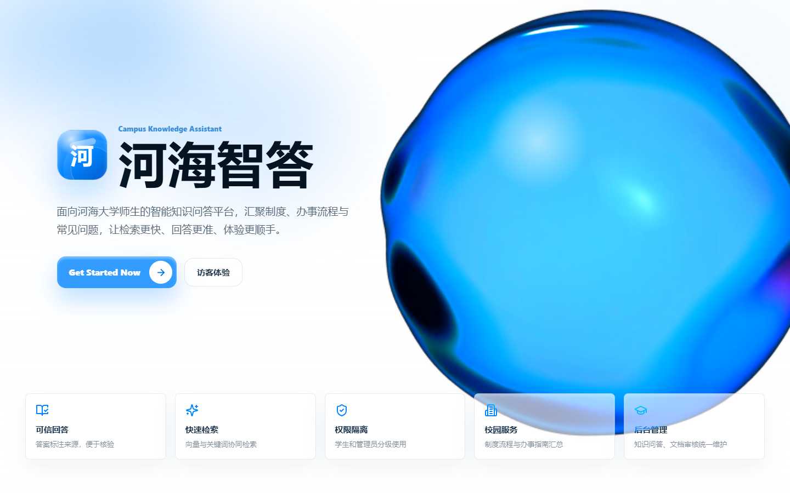
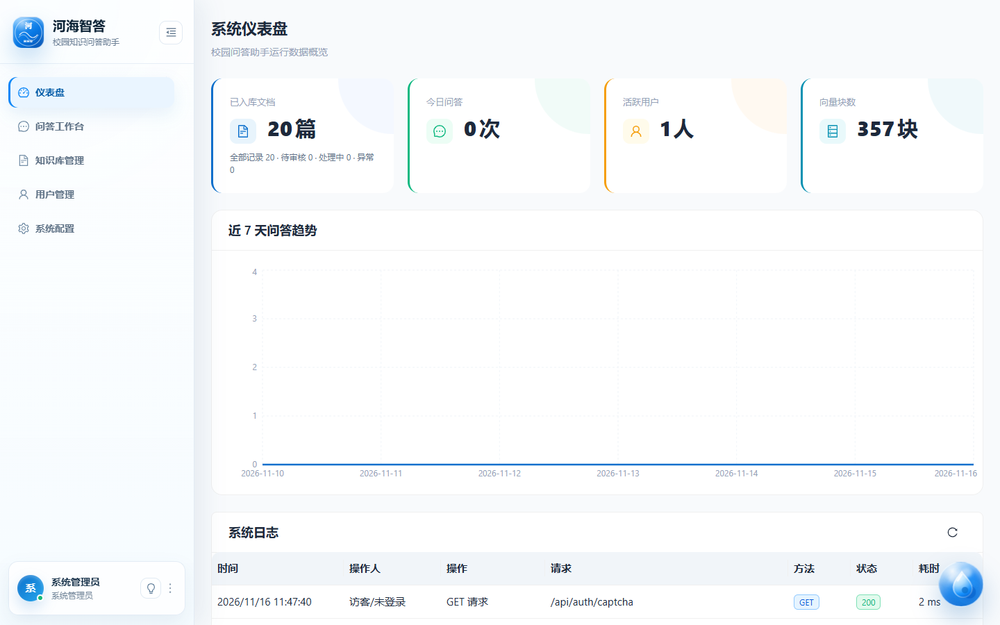
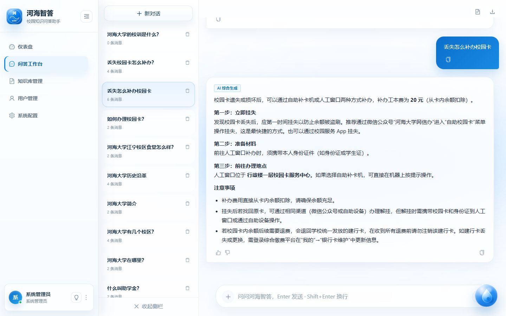
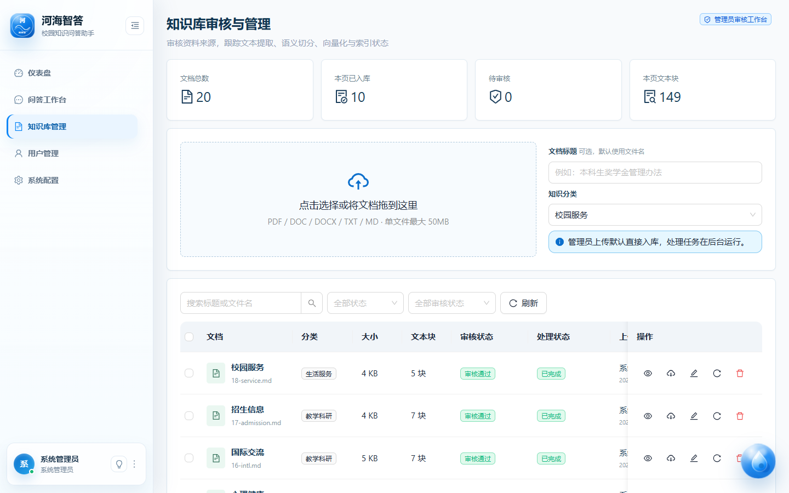
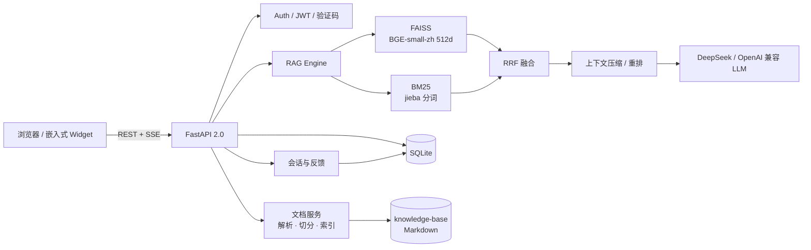

# 河海智答 · 校园知识问答助手

面向河海大学师生的校园知识库智能问答系统：把制度文件、办事流程和常见问题整理成 Markdown 知识库，通过 **FAISS 向量检索 + BM25 关键词检索 + RRF 融合** 召回依据，再由大模型流式生成带来源的回答。

<p>
  
  
  
  
  
  
  
  
</p>

> **课程小组项目**：河海大学校园知识问答助手课程设计。本人（王驰宇）负责 **AI 算法与 RAG 模块**，包括检索策略、查询改写、上下文压缩、热 FAQ 缓存、Self-RAG 纠错与评测；开发报告见 [`docs/reports/`](docs/reports/)。本仓库为整理后的公开版本，用于作品展示与复盘。

<p>
  
  
  
  
</p>

---

## 项目截图

<table>
  <tr>
    <td width="50%"></td>
    <td width="50%"></td>
  </tr>
  <tr>
    <td></td>
    <td></td>
  </tr>
</table>

截图来自 2026-11-16 本机运行（FastAPI `:8000` + Vite `:5173`）。

---

## 功能概览

| 模块 | 能力 |
|---|---|
| **智能问答** | FAQ 热缓存 → 查询改写 → 混合检索 → RRF 融合 → 上下文压缩 → SSE 流式生成；回答附来源片段 |
| **检索策略** | `hybrid` / `dense` / `bm25` / `hyde` / `multi` / `decompose` / `parent_child` / `full`，支持按问题特征自动选路 |
| **知识库管理** | TXT / MD / PDF / DOCX 上传（单文件 50 MB）、文本提取、语义切分、向量化、审核、重处理、下载与批量操作 |
| **会话与反馈** | 会话列表、历史加载、删除、Markdown 导出；点赞写入热 FAQ，点踩触发 Self-RAG 纠错 |
| **用户与权限** | JWT（24 小时）、ADMIN / STUDENT 双角色、PBKDF2 密码哈希、算术验证码、访客登录 |
| **系统管理** | 文档数 / 今日问答 / 活跃用户 / 向量块数统计，近 7 天趋势，操作日志，知识库重建 |
| **嵌入式组件** | Shadow DOM + UMD 单文件，`window.HHUChat.init()` 一行接入任意校园网站 |
| **安全与合规** | 敏感词库、手机号 / 身份证 / 学号脱敏、限流、来源去重、无 API Key 入库 |

## 检索策略

| 策略 | 做法 |
|---|---|
| `hybrid`（默认） | FAISS 向量召回 + BM25 关键词召回 → RRF 融合（k=60，向量 3.0 / 关键词 1.0） |
| `dense` | 仅 FAISS `IndexFlatIP` 内积检索，适合概念型问题 |
| `bm25` | jieba 分词 + `BM25Okapi`，适合电话、编号、时间等精确信息 |
| `hyde` | LLM 先生成假设答案，再用假设答案做向量检索，弥合口语与书面语 |
| `multi` | Multi-Query：LLM 生成 3 路改写，分别检索后 RRF 融合 |
| `decompose` | 把复合问题拆成子问题，逐个检索后合并去重 |
| `parent_child` | Small-to-Big：用 300 字子块检索，返回 1000 字父块上下文 |
| `full` | CRAG：先做相关性自检，低质量时改写问题并重检；可叠加 Self-RAG |
| `auto` | 按口语、对比、精确信息、问题求解等语言特征自动选择上述策略（`ENABLE_AUTO_STRATEGY=true`） |

## 系统架构



- **Embedding**：默认本地 `BAAI/bge-small-zh-v1.5`（512 维）；配置 `DASHSCOPE_API_KEY` 后可切换 `text-embedding-v3`（1024 维）。
- **LLM**：通过 OpenAI 兼容接口调用 DeepSeek，Key 只从环境变量读取。
- **存储**：SQLite 保存用户、文档元数据、会话与日志；FAISS / BM25 索引持久化在 `backend/data/llama_index_storage/`（运行时生成，不入库）。

## 技术栈

| 层级 | 技术 |
|---|---|
| 前端 | React 18、TypeScript 5.5、Vite 5、Ant Design 5、Tailwind CSS、Zustand、ECharts |
| 后端 | Python 3.11+、FastAPI、Pydantic、SQLite、LlamaIndex |
| 检索 | FAISS、BM25（rank-bm25 + jieba）、RRF、Cross-Encoder 重排（可选） |
| AI | DeepSeek（LLM）、BGE-small-zh-v1.5（本地 Embedding） |
| 部署 | Docker Compose（Nginx + FastAPI）、uv、npm |

## 目录结构

```text
Campus-Knowledge-Assistant/
├── backend/
│   ├── app/
│   │   ├── api/                 # auth / chat / documents / users / stats
│   │   ├── models/              # Pydantic 请求与响应模型
│   │   ├── services/            # 认证、会话、文档、统计
│   │   ├── rag/                 # RAG 引擎、热缓存、校园文档读取
│   │   ├── middleware/          # 限流与安全中间件
│   │   ├── main.py              # 应用入口、种子数据、启动加载
│   │   ├── database.py          # SQLite Schema
│   │   └── security.py          # JWT、PBKDF2、验证码
│   ├── tests/                   # 92 项 pytest（单元 / 集成 / 冒烟）
│   ├── data/sensitive.txt       # 敏感词库
│   ├── pyproject.toml
│   └── Dockerfile
├── frontend/
│   └── src/
│       ├── pages/               # 仪表盘 / 问答 / 知识库 / 用户 / 系统配置 / 登录
│       ├── layouts/             # 管理端布局
│       ├── services/            # Axios API 客户端
│       ├── store/               # Zustand 认证与主题
│       └── widget/              # Shadow DOM 嵌入式聊天组件
├── knowledge-base/              # 19 类校园知识文档（Markdown）
├── docs/
│   ├── screenshots/             # 本机运行截图
│   ├── reports/                 # AI 算法层开发报告（Word / PDF）
│   ├── COURSE-ACCEPTANCE.md     # 课程验收与 5 分钟演示顺序
│   ├── architecture.md          # 架构说明
│   ├── api.md                   # API 概览
│   └── rag-strategies.md        # 检索策略与参数
├── scripts/perf_test.py         # 并发问答压测脚本
├── docker-compose.yml           # Nginx + FastAPI
├── nginx.conf
└── README.md
```

## 快速开始

### 环境要求

- Python 3.11+
- Node.js 20+
- [uv](https://docs.astral.sh/uv/)（Python 包管理器）
- 可选：Docker / Docker Compose

### 1. 安装依赖

```bash
# 后端
cd backend
uv sync

# 前端
cd ../frontend
npm install
```

### 2. 配置 API Key

```bash
cd backend
cp .env.example .env
```

编辑 `backend/.env`，至少填入 DeepSeek Key：

```dotenv
LLM_API_KEY=sk-your-deepseek-api-key
LLM_BASE_URL=https://api.deepseek.com/v1
LLM_MODEL=deepseek-chat
```

> Embedding 默认使用本地 BGE 模型，首次启动会自动下载（约 400 MB）；无法联网时可设置 `ALLOW_MODEL_DOWNLOAD=false`，系统会退回 512 维哈希向量，保证服务可启动。仓库不包含任何真实 Key。

### 3. 构建知识库索引（可选）

首次启动会自动加载 `knowledge-base/` 并建立索引；也可以显式重建：

```bash
cd backend
uv run python -m app.cli
```

### 4. 启动服务

终端 1 —— 后端 API（端口 8000）：

```bash
cd backend
uv run uvicorn app.main:app --reload
```

终端 2 —— 前端管理后台（端口 5173）：

```bash
cd frontend
npm run dev
```

### 5. 访问

| 入口 | 地址 | 说明 |
|---|---|---|
| 管理后台 | http://localhost:5173 | 仪表盘 / 问答 / 知识库 / 用户 / 系统配置 |
| API 文档 | http://localhost:8000/docs | FastAPI Swagger |
| 健康检查 | http://localhost:8000/api/health | 返回 `{"status":"ok"}` |

默认管理员：`admin@campus.example` / `admin123`（仅本地演示，部署时请修改）。

### Docker 部署

```bash
# 先构建前端静态文件
cd frontend && npm run build && cd ..

# backend/.env 配置好后启动
docker compose up --build
```

Nginx 监听 `80`，静态页面来自 `frontend/dist/`，`/api` 反向代理到 FastAPI。

## API 概览

| 方法 | 路径 | 权限 | 说明 |
|---|---|---|---|
| GET | `/api/health` | 公开 | 健康检查 |
| GET | `/api/auth/captcha` | 公开 | 获取算术验证码 |
| POST | `/api/auth/register` | 公开 | 注册学生账号 |
| POST | `/api/auth/login` | 公开 | 登录（需验证码） |
| POST | `/api/auth/guest` | 公开 | 访客令牌 |
| POST | `/api/chat/stream` | 登录 | SSE 流式问答 |
| POST | `/api/chat/sync` | 登录 | 同步问答 |
| POST | `/api/chat/feedback` | 登录 | 点赞 / 点踩反馈 |
| GET | `/api/conversations` | 登录 | 会话列表 |
| GET | `/api/conversations/{id}` | 登录 | 会话详情 |
| DELETE | `/api/conversations/{id}` | 登录 | 删除会话 |
| GET | `/api/doc/list` | 管理员 | 文档分页列表 |
| POST | `/api/doc/upload` | 管理员 | 上传文档 |
| POST | `/api/doc/{id}/reprocess` | 管理员 | 重新解析与索引 |
| POST | `/api/doc/{id}/review` | 管理员 | 审核通过 / 驳回 |
| DELETE | `/api/doc/{id}` | 管理员 | 删除文档 |
| GET | `/api/doc/{id}/download` | 管理员 | 下载原文件 |
| GET | `/api/users` | 管理员 | 用户列表 |
| PATCH | `/api/users/{id}` | 管理员 | 修改角色 / 状态 |
| GET | `/api/stats/dashboard` | 管理员 | 仪表盘统计 |
| GET | `/api/stats/trends?days=7` | 管理员 | 问答趋势 |
| GET | `/api/system/logs` | 管理员 | 操作日志 |
| POST | `/api/kb/rebuild` | 管理员 | 重建知识库索引 |

## 运行验证

2026-11-16 在 Windows 11 + Python 3.13 + Node 24 本机实测：

```bash
# 后端测试
cd backend
uv sync --extra dev
uv run pytest -q
# 92 passed, 1 warning in 36.26s

# 前端构建
cd ../frontend
npm run build
# tsc -b && vite build 成功
```

- 后端与前端均能启动，管理员登录、知识库列表、会话历史与问答工作台可正常使用；
- 当前知识库 20 篇文档、357 个索引块（含启动时写入的示例文档）；
- 新问答生成需要有效的 `LLM_API_KEY`，仓库不附带 Key。

## 开发报告

- [`docs/reports/校园问答助手-AI算法层开发报告-一.pdf`](docs/reports/校园问答助手-AI算法层开发报告-一.pdf)：系统架构、Phase 0–3、检索与工程支撑层
- [`docs/reports/校园问答助手-AI算法层开发报告-二.pdf`](docs/reports/校园问答助手-AI算法层开发报告-二.pdf)：反馈闭环、Self-RAG、增量更新、RAGAS 评测与参数扫描
- 同名 `.docx` 可编辑版本一并提供。

报告作者：王驰宇（AI Algorithm Engineer）。报告中的数字均为当时本机实测或脚本输出，未做线上用户量、性能提升等无法核实的表述。

## 团队与分工

本项目为 6 人课程小组项目，按 PM、前端、后端、AI、测试与 DevOps 分工。本人负责 AI 算法与 RAG 模块：

- 检索链路：FAISS / BM25 混合召回、RRF 融合、HyDE、Multi-Query、问题拆解、Parent-Child、CRAG；
- 生成链路：System Prompt、查询改写、上下文压缩、LLM 超时与降级；
- 数据闭环：点赞热 FAQ、点踩 Self-RAG 纠错、会话 trace 与 RAGAS 评测脚本；
- 知识库：校园文档清洗、切分参数扫描（chunk_size=500、overlap=50、TopK=5）。

## 数据与合规说明

- `knowledge-base/` 内容整理自河海大学公开信息与演示文档，仅用于课程演示；如涉及版权或信息更新，请以学校官方发布为准。
- 仓库不包含真实用户数据、API Key、会话日志或数据库文件；`.env`、`backend/logs/`、`backend/data/*.db` 均被忽略。
- 默认管理员密码仅用于本地演示，部署前请修改 `APP_SECRET` 与管理员密码。

## License

[Apache License 2.0](LICENSE)。本项目为课程小组共同成果；如需商用或再分发，请先与全体成员确认。
